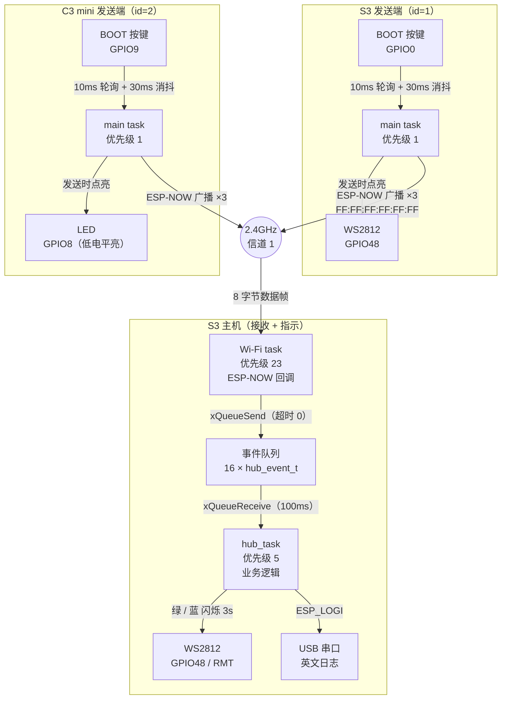
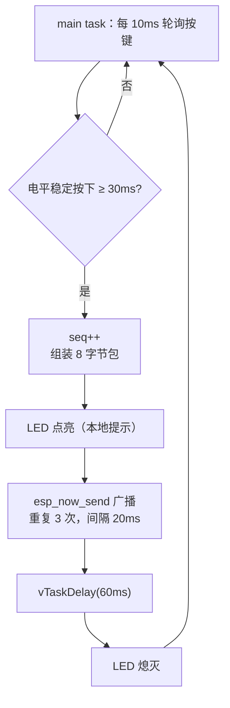
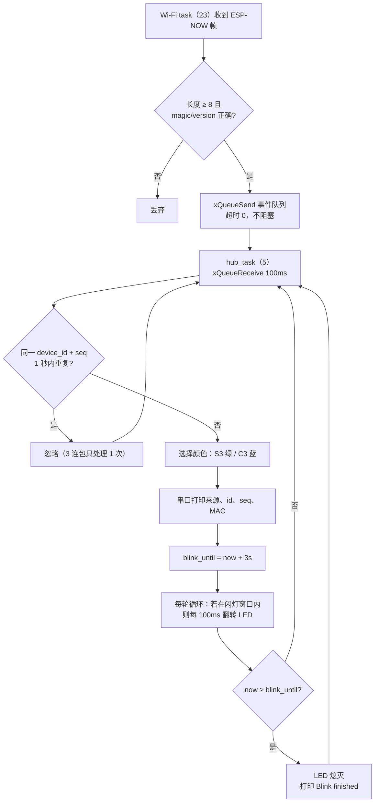

# ESP-NOW 三机按键联动系统架构

> 三块开发板：**S3 主机**、**S3 发送端（id=1）**、**C3 mini 发送端（id=2）**。
> 三块板之间无任何接线，通过 2.4GHz ESP-NOW 广播通信；各自通过 USB 供电和查看串口。
> 运行环境：ESP-IDF v5.5.6 + FreeRTOS。

---

## 1. 系统总体框图

---

## 2. FreeRTOS 任务模型

> ESP-IDF 中 `xTaskCreate` 的栈大小单位是**字节**；优先级数字**越大越高**（本工程 configMAX_PRIORITIES = 25）。
> S3 是双核（FreeRTOS SMP），C3 是单核（`CONFIG_FREERTOS_UNICORE=y`）。

### 2.1 S3 / C3 发送端（espnow_s3_btn、espnow_c3_btn）

| 任务     | 创建者       |   优先级 | 职责                                    |
| ------ | --------- | ----: | ------------------------------------- |
| `main` | IDF 启动代码  | **1** | `app_main` 里的业务循环：10ms 轮询按键、发广播、点 LED |
| `wifi` | Wi-Fi 协议栈 |    23 | 发送 ESP-NOW 帧、执行发送完成回调                 |

**关键点**

- Wi-Fi 任务（23）优先级高于应用任务（5 或 1），射频事件会抢占业务代码。
- ESP-NOW 接收回调运行在 Wi-Fi 任务上下文，**不能阻塞**，所以回调只做过滤 + `xQueueSend(..., 0)`；真正的打印和闪放在 `hub_task`。

---

## 3. ESP-NOW 收发

### 3.1 数据包（8 字节，广播）//TO DO 需要更新

| 偏移 | 字段          | 长度 | 值 / 含义               |
| ---: | ------------- | ---: | ----------------------- |
|    0 | `magic`       |    1 | `0xE5`，过滤无关帧      |
|    1 | `device_type` |    1 | 传感器设备              |
|    2 | `device_id`   |    1 | 同一种传感器的不同设备  |
|    3 | `event`       |    1 | 数据上报 或 ACK         |
|    4 | `seq`         |    2 | 每次按键 +1，主机去重用 |
|    6 | 数据          |   10 | 数据内容，小端          |

- 目的地址：`FF:FF:FF:FF:FF:FF`（广播），主机无需预知发送端 MAC。
- 所有设备固定 **2.4GHz 信道 1**，不连接路由器。
- 广播没有 ACK/重传，因此每次按键连发 **3 包**（间隔 20ms）。

### 3.2 发送端数据流

### 3.3 主机接收数据流

